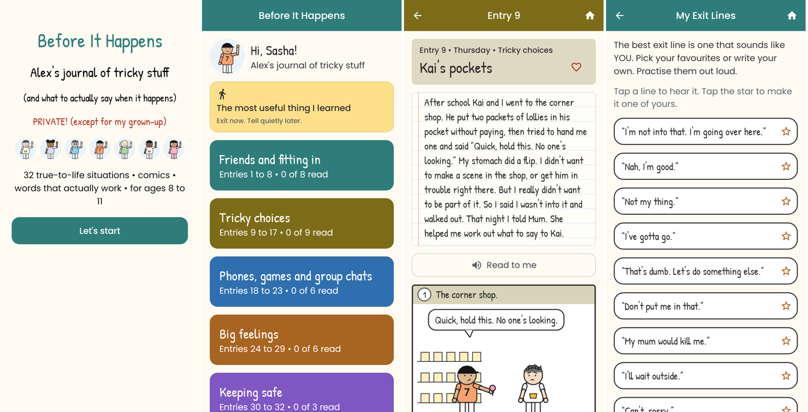
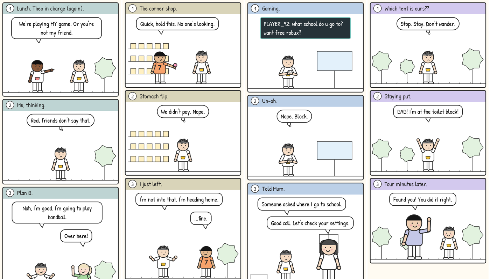

# Before It Happens: Alex's Journal (Android)

An Android app for kids aged 8 to 11, built from *Before It Happens: Alex's Journal*
([`docs/Before_It_Happens_Journal.pdf`](docs/Before_It_Happens_Journal.pdf)). Alex, a Year 5 kid, writes up 32
tricky situations and what to actually say when they happen: **exit now** with a low-key line, then **tell
quietly later**. See [`docs/REQUIREMENTS.md`](docs/REQUIREMENTS.md) for the sources and what changed from the
first edition.




## What's in it

- **Onboarding:** the cover, "Hi. I'm Alex.", "This copy belongs to" and reading buddy, pick an avatar from the
  crew, then the most useful thing Alex learned.
- **Home:** The most useful thing I learned (exit now, tell quietly later, what you always tell), the five
  sections, Magic Words, Activities, Meet the crew, How to read each entry, and a grown-ups area.
  A red **Who can help** button is on every kids' screen.
- **32 journal entries:** Alex's handwritten journal bit on ruled paper, a three-panel comic (panels animate in;
  tap one to hear it), What I figured out, What I can say right now (tap to hear, plus a "Say it out loud"
  practice prompt), Later, Magic Words with **Got it!**, Try it! (with a shortcut to the matching page), My Turn
  (saved on the device) and a collapsed Grown-up Corner. "Read to me" reads the whole entry.
- **Games:** Magic Words flip cards with Quiz me, What If? cards (Show me jumps to the entry), Keep It or Tell It?
  with a score, and Good Friend or Bossy Friend? sorting.
- **My pages:** My Exit Lines, Safety Hand, Things I Know By Heart (behind the PIN, with a Practise mode),
  Personal Bests, Calm-Down Plan (with a 5-breath flower and candle animation), Our Tech Rules.
- **Who can help:** 000 and Kids Helpline open the dialler (`ACTION_DIAL`); the child presses call.
- **Grown-ups area (PIN):** the grown-up notes, services and further reading (websites appear only here), every
  Grown-up Corner tip, change PIN and reset all data.

## Privacy and safety

- No `INTERNET` permission (it's removed in the manifest even if a library asks for it). No ads, accounts,
  analytics, notifications or purchases.
- Everything typed is stored with DataStore on the device only. `allowBackup="false"` and the data extraction
  rules exclude it from cloud backup and device transfer.
- The PIN is stored as a salted SHA-256 hash. Unlocking lasts until the app goes into the background.
- "Say it out loud" never uses the microphone. Speech recognition was optional in the brief, so it is skipped
  and nothing is recorded. Read-aloud uses the on-device text-to-speech engine (en-AU when available).

## Content is data

All wording lives in `app/src/main/assets/`:

- `stories.json`: the 5 sections and 32 entries (journal text, comic panels, What I figured out, What I can say
  right now, Later, Magic Words, Try it!, Grown-up Corner), the games and the activity lists.
- `book.json`: the cover and front pages, the most useful thing I learned, activity page intros, Who can help,
  the character specs, and `whatIfStories`, which maps each of the 27 What If? cards to an entry.

Editing these files changes the app without code changes. The comics are drawn in Compose `Canvas` from
each panel's `scene`, `people` (`who`, `x`, `face`, `arm`, `item`, `facingLeft`, `tears`) and `speech`.
Characters can have a `pocket`, `stripes`, a sports `number`, `glasses` and `freckles`, as in the journal drawings.

## Build

Requirements: JDK 17 or newer, Android SDK 36.

```bash
./gradlew :app:assembleDebug          # APK in app/build/outputs/apk/debug/
./gradlew :app:testDebugUnitTest      # content checks + screenshot tests
```

`ContentTest` checks that all 32 entries, the games and the comic data are complete and drawable.
`ScreenshotTest` uses Robolectric to render every comic and a walk through the app to
`app/build/screenshots/`, so you can check the art without a device.

Stack: Kotlin, Jetpack Compose, Material 3, Navigation Compose, DataStore, kotlinx.serialization;
min SDK 26, target SDK 36. Fonts: Poppins and Patrick Hand (SIL Open Font License, see `app/src/main/assets/OFL-*.txt`).

## Notes and choices

See [`docs/REQUIREMENTS.md`](docs/REQUIREMENTS.md). In short: My Turn is kept from the original app brief;
characters get light skin tones; the grown-ups the PDF draws alike get different colours; progress tied to the
old story numbers resets after the update; services and numbers are for Victoria, Australia (checked October 2026).
